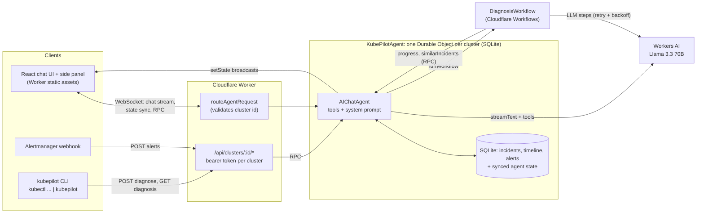

# KubePilot

**Live demo: https://cf-ai-kubepilot.drashtimagia02.workers.dev**

An AI incident copilot for Kubernetes on Cloudflare. Paste `kubectl` output, logs or an alert, or let Alertmanager send it. KubePilot triages it like a calm SRE, runs a durable multi-step diagnosis, suggests commands (each marked read-only or cluster-changing), and remembers your incidents and cluster across sessions.

It measures itself: on 28 labelled incidents the correct cause was in the top 3 hypotheses **26 times out of 28**, and none of the 111 hypotheses stated a concrete identifier or number that was missing from the input (a heuristic check). Details and caveats are in [Evaluation](#evaluation).

## 30-second demo

1. Open the live URL.
2. Click **CrashLoopBackOff** (or the Pending or ImagePullBackOff sample). The kubectl output is sent as a chat message and KubePilot answers with a failure mode, a confidence level, one next piece of evidence to fetch, and a tagged command.
3. Click **Run diagnosis**. The side panel (the **Details** button on a phone) ticks through the steps live, then shows ranked hypotheses, each with a confirm command, a copy button and a read-only or "changes the cluster" flag. The same hypotheses are written to the incident timeline, labelled as AI guesses.
4. Type "we run Calico on bare metal", reload the page, then ask "which CNI are we on?". It remembers.

Every browser gets its own private workspace (an agent instance named in `localStorage`), so you do not see anyone else's chat. Open `/?cluster=<id>` to join a named workspace.

## Architecture



**Chat turn:** the browser talks to one Durable Object over a WebSocket. The agent builds a system prompt from stored memory, streams Llama 3.3 through the Vercel AI SDK, and lets the model call tools (parse kubectl output, look up a runbook, write memory). Every state change is broadcast to the UI.

**Diagnosis:** "Run diagnosis", an incoming alert, or the CLI starts a Workflow instance. Each `step.do` is checkpointed, and LLM steps retry with exponential backoff. Steps report progress back to the agent, which updates synced state, so the progress panel is live. When the Workflow finishes, the agent writes the result to the incident timeline.

## The four required components

| Requirement                                              | Where it lives                                                                                                                                                                                                                                                                                                     |
| -------------------------------------------------------- | ------------------------------------------------------------------------------------------------------------------------------------------------------------------------------------------------------------------------------------------------------------------------------------------------------------------ |
| **LLM**: Llama 3.3 on Workers AI                         | [src/model.ts](src/model.ts) (model id, token limit), [src/server.ts](src/server.ts) `onChatMessage` (streaming chat), [src/llm.ts](src/llm.ts) (workflow and eval calls), [src/ai-binding.ts](src/ai-binding.ts) (stream de-dupe workaround)                                                                      |
| **Workflow / coordination**: Workflows + Agents SDK      | [src/workflow.ts](src/workflow.ts) (`DiagnosisWorkflow extends AgentWorkflow`), [src/diagnosis-steps.ts](src/diagnosis-steps.ts) (pure step logic), `runWorkflow` and `onWorkflow*` callbacks in [src/server.ts](src/server.ts), `workflows` binding in [wrangler.jsonc](wrangler.jsonc)                           |
| **User input**: chat UI, plus webhook and CLI            | [src/app.tsx](src/app.tsx), [src/side-panel.tsx](src/side-panel.tsx) (served as Worker static assets); [src/api.ts](src/api.ts) and [src/alerts.ts](src/alerts.ts) (Alertmanager webhook, per-cluster tokens); [bin/kubepilot.mjs](bin/kubepilot.mjs) (CLI)                                                        |
| **Memory / state**: Durable Object SQLite + synced state | [src/incident-store.ts](src/incident-store.ts) (incidents, timeline, alert links in SQLite), `setState` in [src/server.ts](src/server.ts) (cluster facts, active incident, diagnosis; synced to every client), [src/memory.ts](src/memory.ts) (prompt memory rules, state migration), [src/types.ts](src/types.ts) |

## Evaluation

`npm run eval` runs 28 labelled incidents ([eval/scenarios.ts](eval/scenarios.ts)) through the real diagnosis pipeline against the real model and writes [eval/RESULTS.md](eval/RESULTS.md) and `eval/results.json`. Each scenario is what an operator would paste (a `describe` plus the log line or event that shows why), and its root cause is determinable from that input alone. Categories covered: crash loops (8), OOM kills (3), image pulls (3), scheduling (4), eviction, volume attach, probes, node health (2), config errors (2), service endpoints, DNS and RBAC.

Latest run (Llama 3.3 70B, 28 scenarios, 0 errors):

| Metric                                             | Result          |
| -------------------------------------------------- | --------------- |
| Correct failure category                           | 26/28 (93%)     |
| Correct cause is the top hypothesis                | 21/28 (75%)     |
| Correct cause is in the top 3                      | **26/28 (93%)** |
| Suggested confirm commands that are read-only      | 110/111 (99%)   |
| Hypotheses stating a fact that is not in the input | **0/111 (0%)**  |

What these numbers do and do not mean:

- **One run, a stochastic model.** Expect a few points of variance between runs. The harness uses the same step functions, prompts, JSON validation and read-only check as the Workflow, but runs steps in-process with a retry loop instead of as durable Workflow steps.
- **Cause matching is keyword-based.** A hypothesis counts as correct if its title or reasoning contains an expected phrase. That is strict in some cases (a valid paraphrase can miss; `crash-bad-entrypoint` suggested "wrong command or args" and was scored wrong) and cannot judge reasoning quality.
- **The grounding check is a heuristic.** It extracts namespaces, pod names, IPs, memory sizes, images, versions, exit codes and restart counts from each hypothesis and checks each appears in the input. It would miss a fabricated claim phrased in prose, so read 0% as "no concrete invented identifiers or numbers", not "no hallucination of any kind".
- **The read-only rate uses our own classifier** ([src/diagnosis.ts](src/diagnosis.ts) `isReadOnly`), which is tested against labelled commands. It measures how often the model proposes read-only confirm commands.
- **I changed things after seeing results, so treat the numbers accordingly.** A first pass ([eval/RESULTS-first-pass.md](eval/RESULTS-first-pass.md)) scored 23/28 top-1 and 26/28 top-3, but used cause keywords that were too generic (`node`, `service`, `code`). I tightened the keyword lists, and the eval also exposed a real parser bug (exit code 137 was always reported as OOMKilled, though a failed liveness probe also exits 137), which I fixed. I also added one general prompt sentence ("rank causes the evidence supports first"). Those are the changes between the two runs.
- **Known misses.** Both top-3 misses are crash loops where the specific cause (a missing binary, a nil-pointer panic) was in the log. Most top-1 misses (`crash-db-refused`, `crash-liveness`, `pull-not-found`, `sched-pvc-unbound`, `oom-java-heap`) put a generic cause from the runbook first and the right one second. DNS and RBAC failures were classified into the nearest runbook category instead of "Other".

## Alerts and the CLI

Each cluster is its own Durable Object (`/api/clusters/<id>/...`), and each has its own token, derived as `HMAC-SHA256(WEBHOOK_SECRET, clusterId)` so one secret covers every cluster and a token only works for its cluster.

```bash
# 1. Make a token for a cluster id (3-40 chars: a-z, 0-9, -). Reads WEBHOOK_SECRET from the env or .dev.vars.
npm run token -- prod-eu

# 2. Point Alertmanager at it (receiver config):
#    url: https://<your-worker>/api/clusters/prod-eu/alerts
#    http_config: { authorization: { type: Bearer, credentials: <token> } }

# 3. Or test by hand
curl -X POST https://<your-worker>/api/clusters/prod-eu/alerts \
  -H "Authorization: Bearer $TOKEN" -H 'content-type: application/json' \
  -d '{"alerts":[{"status":"firing","labels":{"alertname":"KubePodCrashLooping","namespace":"payments","pod":"payments-api-7d9f8b6c5-x2k4p","severity":"critical"},"annotations":{"summary":"Pod is crash looping"},"fingerprint":"abc123"}]}'
```

A firing alert opens an incident with the alert as evidence and starts a diagnosis; a re-fire of the same alert is deduplicated; a resolved alert marks its incident mitigated. At most 5 incidents are opened per request, at most 20 alerts are accepted, and bodies are capped at 200 KB. Open the same cluster in the UI at `/?cluster=prod-eu` to watch it.

```bash
export KUBEPILOT_URL=https://<your-worker> KUBEPILOT_CLUSTER=prod-eu KUBEPILOT_TOKEN=$(npm run -s token -- prod-eu)
kubectl describe pod payments-api-7d9f8b6c5-x2k4p -n payments | node bin/kubepilot.mjs
```

The CLI sends text and prints the ranked hypotheses with `[read-only]` or `[CHANGES THE CLUSTER]` flags. It never runs kubectl or any suggested command. Run `npm link` once to call it as `kubepilot`.

## How it works

- **Triage behavior** is in [src/system-prompt.ts](src/system-prompt.ts): failure mode and confidence, one next piece of evidence, tagged commands, and a rule to state only what the paste, tool results or memory show.
- **`parseK8sOutput`** ([src/k8s-parse.ts](src/k8s-parse.ts)) is a pure parser for `kubectl get`, `describe`, logs and alert text. **`lookupRunbook`** ([src/runbooks.ts](src/runbooks.ts)) has 10 failure modes with causes, read-only checks and fixes.
- **Memory:** incidents (status, severity, summary), a per-incident timeline (evidence, hypothesis, action, note, each with a source) and cluster facts (version, CNI, platform, notes). Cluster facts and the active incident's recent timeline go into the prompt each turn, size-limited.
- **Honesty rules:** "evidence" entries must appear verbatim in something the user said, or they are stored as hypotheses ([src/memory.ts](src/memory.ts) `resolveKind`). Workflow output is always stored as hypotheses. Whether a command is read-only is decided by our code, never by the model. Suggested commands get their `<ns>`, `<pod>` and `<node>` filled from the parsed evidence ([src/placeholders.ts](src/placeholders.ts)), and a placeholder stays as written when the evidence does not say. KubePilot only suggests commands. It never runs them.
- **Optional approval step:** tick "Ask me before keeping cluster-changing suggestions" and the Workflow pauses at `waitForApproval` if any suggestion would change the cluster. Approve keeps them, Reject (or a 10 minute timeout) keeps only the read-only ones. It is off by default so the demo does not stall.
- **Limits:** pasted text is cut in the middle at 12,000 characters before it reaches the model (the model is told, and says so); only the last 20 messages are sent; model output is capped at 1,024 tokens; the input box accepts 50,000 characters; API bodies are capped at 200 KB.
- **Errors:** Workers AI rate limits, capacity errors and timeouts become one short message ([src/errors.ts](src/errors.ts)); raw errors go to Worker logs only.

## Design decisions

- **Suggest, never execute.** Giving a model `kubectl` access is the obvious feature and the wrong first one. KubePilot reads text and proposes commands, and a small, tested, conservative classifier labels them. When it cannot tell, it says the command changes the cluster.
- **Pure step logic, thin Workflow.** The pipeline is plain functions with injected dependencies ([src/diagnosis-steps.ts](src/diagnosis-steps.ts)). The Workflow only supplies durability and the real model. That is why the same code runs in unit tests with a mocked AI, in the Workflow, and in the evaluation harness.
- **A durable Workflow, not a longer chat turn.** A diagnosis is several LLM calls that can each fail. Checkpointed steps with retry and backoff survive a restart, report progress, and can pause for a human.
- **One Durable Object per cluster.** State, SQLite and the WebSocket live together, and isolation is the default. The browser demo gets a private workspace per visitor.
- **Facts versus guesses are stored differently.** Each timeline entry has a source. Anything from the model is a hypothesis and is shown as one.
- **Measure it.** The evaluation harness found a parser bug and generic scoring keywords that a demo never would have.

## Setup

```bash
npm install
npx wrangler login      # one-time; needed even for local runs, see below
cp .dev.vars.example .dev.vars   # then put a random value in WEBHOOK_SECRET (e.g. openssl rand -hex 32)
```

## Run locally

```bash
npm run dev             # http://localhost:5173
```

Workers AI has no local simulator, so `wrangler.jsonc` sets `"ai": { "remote": true }` and model calls go to Cloudflare:

- You must be logged in (`wrangler login`, or `CLOUDFLARE_API_TOKEN` in `.env`) and have a registered `workers.dev` subdomain, or remote mode fails with error 10063.
- Local chats use real Workers AI and count toward your usage and the free daily allowance. `npm run eval` makes about 60 model calls.
- Durable Object state is local, under `.wrangler/` (delete it to reset memory).
- If dev fails with "newest date supported by this server binary", upgrade `wrangler` and `@cloudflare/vite-plugin`, then approve the new `workerd`/`esbuild` install scripts (`npm install-scripts approve ...`).

## Deploy

```bash
npx wrangler secret put WEBHOOK_SECRET   # once; signs the per-cluster API tokens
npm run deploy                           # vite build && wrangler deploy
```

This deploys the Worker `cf-ai-kubepilot`, creates the `kubepilot-diagnosis` Workflow, and applies the Durable Object migration. It is served at `https://cf-ai-kubepilot.<your-subdomain>.workers.dev`. Workers AI uses a binding, not a key. Without `WEBHOOK_SECRET` the chat UI works and the `/api` routes answer 503.

## Tests

```bash
npm run check           # oxfmt, oxlint, tsc (strict), vitest
npm test                # unit tests only
npm run eval            # live evaluation against the real model (see above)
npm run types           # regenerate env.d.ts after editing wrangler.jsonc
```

Covered by 110 unit tests: the parser (6 realistic fixtures plus alerts), runbook lookup, the diagnosis steps with a mocked AI (ordering, ranking, retry on bad JSON, approval, placeholders, read-only classification, timeline entries), the incident, timeline and alert-link store against real SQLite (`node:sqlite`), evidence verification, prompt memory, state migration, message limits, alert parsing, token signing and verification, API path matching, cluster ids, the CLI with a faked network, the evaluation scorers, error mapping and the stream de-dupe wrapper.

There is no full agent integration test. Running the Durable Object under test needs `@cloudflare/vitest-pool-workers`, which is heavy, and Workers AI cannot be simulated locally. Everything around the agent is pure and tested instead, and the agent, the webhook, the CLI and the approval pause were exercised by hand against `npm run dev`.

## Trade-offs and limitations

- **A workspace id is the only access control for the browser UI.** The id is random and private by default, but anyone who has the `?cluster=` link can read and write that workspace. The machine API is token-protected; the browser is not. Production would need real authentication.
- **One shared secret signs every cluster token.** Rotating it invalidates every token. There is no per-token revocation.
- **Suggestions only.** KubePilot has no cluster access. It reasons about text you send, so it is only as good as that text. It never executes commands.
- **LLM output is untrusted.** JSON from the model is validated with zod and retried. Commands are classified by a conservative check: anything that is not clearly a read-only `kubectl` command is flagged as changing the cluster.
- **Accuracy is good, not perfect.** See [Evaluation](#evaluation): about 3 in 4 first hypotheses are right, and generic "application error on startup" often outranks a cause that is visible in the log.
- **Approval is opt-in and the live pause is hard to trigger.** The model currently suggests mostly read-only confirm commands, so the approval pause rarely fires on real input. It was exercised by forcing it.
- **Evidence check is literal.** A paraphrase of the user's words is stored as a hypothesis, not evidence. That is deliberately strict.
- **Llama 3.3 context is about 24k tokens**, so very long logs are trimmed in the middle and the middle is lost.
- **Workers AI streaming workaround.** Llama 3.3 streams duplicated fields that `workers-ai-provider@3.3.1` mishandles; [src/ai-binding.ts](src/ai-binding.ts) strips them. Provider v4 needs `ai@7`; remove the wrapper after upgrading.
- **Parser is heuristic.** It targets standard `kubectl` column layouts in English. Custom output formats (`-o wide` variants, JSON, other locales) are only partly understood.
- **Stored message size is not capped server-side.** The UI limits input to 50,000 characters and the model only sees 12,000, but a custom WebSocket client could store larger messages.
- **One diagnosis at a time per cluster.** A second alert that arrives while one is running opens its incident but waits for you to run the diagnosis.
