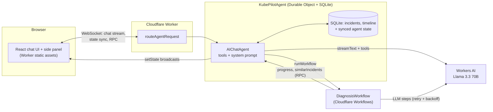

# KubePilot

**Live demo: https://cf-ai-kubepilot.drashtimagia02.workers.dev**

An AI incident copilot for Kubernetes on Cloudflare. Paste `kubectl` output, logs or an alert. KubePilot triages it like a calm SRE, runs a durable multi-step diagnosis, suggests commands (each marked read-only or cluster-changing), and remembers your incidents and cluster across sessions.

## 30-second demo

1. Open the live URL.
2. Click **CrashLoopBackOff** (or the Pending or ImagePullBackOff sample). The kubectl output is sent as a chat message and KubePilot answers with a failure mode, a confidence level, one next piece of evidence to fetch, and a tagged command.
3. Click **Run diagnosis**. The side panel (the **Details** button on a phone) ticks through five steps live, then shows ranked hypotheses, each with a confirm command, a copy button and a read-only or "changes the cluster" flag. The same hypotheses are written to the incident timeline, labelled as AI guesses.
4. Type "we run Calico on bare metal", reload the page, then ask "which CNI are we on?". It remembers.

## Architecture



**Chat turn:** the browser talks to one Durable Object over a WebSocket. The agent builds a system prompt from stored memory, streams Llama 3.3 through the Vercel AI SDK, and lets the model call tools (parse kubectl output, look up a runbook, write memory). Every state change is broadcast to the UI.

**Diagnosis:** "Run diagnosis" starts a Workflow instance. Each `step.do` is checkpointed, and LLM steps retry with exponential backoff. Steps report progress back to the agent, which updates synced state, so the progress panel is live. When the Workflow finishes, the agent writes the result to the incident timeline.

## The four required components

| Requirement                                              | Where it lives                                                                                                                                                                                                                                                                                           |
| -------------------------------------------------------- | -------------------------------------------------------------------------------------------------------------------------------------------------------------------------------------------------------------------------------------------------------------------------------------------------------- |
| **LLM**: Llama 3.3 on Workers AI                         | [src/model.ts](src/model.ts) (model id), [src/server.ts](src/server.ts) `onChatMessage` (streaming chat), [src/workflow.ts](src/workflow.ts) (workflow LLM calls), [src/ai-binding.ts](src/ai-binding.ts) (stream de-dupe workaround)                                                                    |
| **Workflow / coordination**: Workflows + Agents SDK      | [src/workflow.ts](src/workflow.ts) (`DiagnosisWorkflow extends AgentWorkflow`), [src/diagnosis-steps.ts](src/diagnosis-steps.ts) (pure step logic), `runWorkflow` and `onWorkflow*` callbacks in [src/server.ts](src/server.ts), `workflows` binding in [wrangler.jsonc](wrangler.jsonc)                 |
| **User input**: chat UI                                  | [src/app.tsx](src/app.tsx), [src/side-panel.tsx](src/side-panel.tsx), [src/copy-button.tsx](src/copy-button.tsx); built by Vite and served from the same Worker as static assets                                                                                                                         |
| **Memory / state**: Durable Object SQLite + synced state | [src/incident-store.ts](src/incident-store.ts) (incidents and timeline in SQLite), `setState` in [src/server.ts](src/server.ts) (cluster facts, active incident, diagnosis; synced to every client), [src/memory.ts](src/memory.ts) (prompt memory rules, state migration), [src/types.ts](src/types.ts) |

## How it works

- **Triage behavior** is in [src/system-prompt.ts](src/system-prompt.ts): failure mode and confidence, one next piece of evidence, tagged commands, and a rule to state only what the paste, tool results or memory show.
- **`parseK8sOutput`** ([src/k8s-parse.ts](src/k8s-parse.ts)) is a pure parser for `kubectl get`, `describe` and logs. **`lookupRunbook`** ([src/runbooks.ts](src/runbooks.ts)) has 10 failure modes with causes, read-only checks and fixes.
- **Memory:** incidents (status, severity, summary), a per-incident timeline (evidence, hypothesis, action, note) and cluster facts (version, CNI, platform, notes). Cluster facts and the active incident's recent timeline go into the prompt each turn, size-limited.
- **Honesty rules:** "evidence" entries must appear verbatim in something the user said, or they are stored as hypotheses ([src/memory.ts](src/memory.ts) `resolveKind`). Workflow output is always stored as hypotheses. Whether a command is read-only is decided by our code ([src/diagnosis.ts](src/diagnosis.ts) `isReadOnly`), never by the model. KubePilot only suggests commands. It never runs them.
- **Limits:** pasted text is cut in the middle at 12,000 characters before it reaches the model (the model is told, and says so); only the last 20 messages are sent; model output is capped at 1,024 tokens; the input box accepts 50,000 characters.
- **Errors:** Workers AI rate limits, capacity errors and timeouts become one short message ([src/errors.ts](src/errors.ts)); raw errors go to Worker logs only.

## Setup

```bash
npm install
npx wrangler login      # one-time; needed even for local runs, see below
```

## Run locally

```bash
npm run dev             # http://localhost:5173
```

Workers AI has no local simulator, so `wrangler.jsonc` sets `"ai": { "remote": true }` and model calls go to Cloudflare:

- You must be logged in (`wrangler login`, or `CLOUDFLARE_API_TOKEN` in `.env`) and have a registered `workers.dev` subdomain, or remote mode fails with error 10063.
- Local chats use real Workers AI and count toward your usage and the free daily allowance.
- Durable Object state is local, under `.wrangler/` (delete it to reset memory).
- If dev fails with "newest date supported by this server binary", upgrade `wrangler` and `@cloudflare/vite-plugin`, then approve the new `workerd`/`esbuild` install scripts (`npm install-scripts approve ...`).

## Deploy

```bash
npm run deploy          # vite build && wrangler deploy
```

This deploys the Worker `cf-ai-kubepilot`, creates the `kubepilot-diagnosis` Workflow, and applies the Durable Object migration. It is served at `https://cf-ai-kubepilot.<your-subdomain>.workers.dev`. No secrets are needed: Workers AI uses a binding, not a key.

## Tests

```bash
npm run check           # oxfmt, oxlint, tsc (strict), vitest
npm test                # unit tests only
npm run types           # regenerate env.d.ts after editing wrangler.jsonc
```

What is covered: the parser (6 realistic fixtures), runbook lookup, the diagnosis steps with a mocked AI (ordering, ranking, retry on bad JSON, read-only classification, timeline entries), the incident and timeline store against real SQLite (`node:sqlite`), evidence verification, prompt memory, state migration, message limits, error mapping and the stream de-dupe wrapper. There is no full agent integration test: running the Durable Object under test needs `@cloudflare/vitest-pool-workers`, which is heavy, and Workers AI cannot be simulated locally. Everything around the agent is pure and tested instead, and the agent is exercised by hand in the demo path above.

## Trade-offs and limitations

- **One shared agent.** The client uses the instance name `default`, so everyone who opens the URL shares one memory, chat and incident list. That is right for a demo and wrong for production: it needs per-user or per-team instances and authentication. There is none.
- **Suggestions only.** KubePilot has no cluster access. It reasons about text you paste, so it is only as good as the paste. It never executes commands.
- **LLM output is untrusted.** JSON from the model is validated with zod and retried. Commands are classified by a conservative allowlist-style check: anything that is not clearly a read-only `kubectl` command is flagged as changing the cluster.
- **Evidence check is literal.** A paraphrase of the user's words is stored as a hypothesis, not evidence. That is deliberately strict.
- **Llama 3.3 context is about 24k tokens**, so very long logs are trimmed in the middle and the middle is lost.
- **Workers AI streaming workaround.** Llama 3.3 streams duplicated fields that `workers-ai-provider@3.3.1` mishandles; [src/ai-binding.ts](src/ai-binding.ts) strips them. Provider v4 needs `ai@7`; remove the wrapper after upgrading.
- **Parser is heuristic.** It targets standard `kubectl` column layouts in English. Custom output formats (`-o wide` variants, JSON, other locales) are only partly understood.
- **Stored message size is not capped server-side.** The UI limits input to 50,000 characters and the model only sees 12,000, but a custom WebSocket client could store larger messages.
